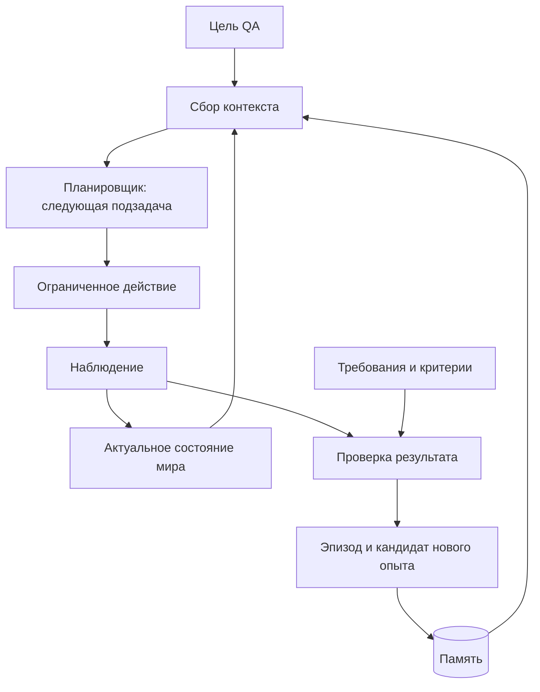

# Игровой агент с памятью

Актуальная точка на 27.10.2026: docs/AGENT_HANDOFF.md и docs/RESTORE_ON_NEW_PC.md. Ниже сохранены исходные архитектурные предложения; фактические реализации и подтверждения определяются текущими карточками и кодом, а не старыми статусами.
Долгосрочная цель — агент для Ocean Nomad, которому QA задаёт цель обычным языком. Агент получает данные о мире, ориентируется, строит план, действует, проверяет результат и сохраняет опыт для следующих задач. Поддерживаемые задачи расширяются по мере появления проверенных знаний, инструментов и навыков; возможность выполнять любую задачу игры заранее не обещается.

## Из чего состоит «мозг»

1. **Модель** понимает цель, выбирает ближайшую подзадачу и объясняет неопределённость.
2. **Наблюдатель** получает изображение и доступную телеметрию через адаптер выбранной среды.
3. **Состояние мира** хранит актуальные положения, ориентиры, инвентарь и прогресс задачи с указанием источника и времени.
4. **Поиск памяти** находит подходящие правила, навыки, удачные и неудачные эпизоды.
5. **Исполнитель** выполняет ограниченное действие обычным игровым управлением.
6. **Проверяющий** сопоставляет наблюдаемый результат с заранее определёнными требованиями.
7. **Запись опыта** сохраняет эпизод и предлагает новое знание для подтверждения.

Это архитектура нашей системы. MCP предоставляет доступ к инструментам; хранение, поиск, проверку и актуализацию памяти проектируем отдельно. Взаимодействие модели через API — один из будущих способов запуска. Первый прототип можно развивать через Codex/Cursor без самостоятельного API-приложения.

## Что означает накопление опыта

В этой архитектуре новые сведения сохраняются во внешнем хранилище и подаются модели при подходящей задаче. Изменение весов модели и обучение собственной модели в первый этап не входят. Новый чат получает нужный опыт через чтение файлов или вызов поиска, а не через ожидание, что модель сама вспомнит прошлый запуск.

Перед решением агент загружает краткое текущее состояние, применимые требования и небольшую подборку подтверждённых навыков и предупреждений. Полные логи остаются в хранилище и извлекаются по ссылкам при необходимости. Так память может расти без передачи всей истории при каждом действии.

## Как ориентироваться в 3D

Начальная пространственная модель — объекты и связи между ними: где игрок, на что смотрит камера, какой ориентир рядом, что доступно для взаимодействия и как вернуться к известной точке.

При доступе к Unity используем предоставленные координаты, идентификаторы объектов и ориентацию. На плоту особенно полезны координаты относительно самого плота: движение плота в мире не должно менять расположение закреплённых на нём объектов в локальной карте.

## Источники состояния и текущий порядок

Главная среда — Unity Editor с фиксированным профилем наблюдаемости. Структурированное чтение компонентов дополняем изображением и проверкой фактического результата. Просмотр реализации и ожидаемое QA-поведение разделяем.

Данные об игроке, предметах, воде/суше и квестах потребуют отдельного адаптера; наличие MCP их автоматически не нормализует. [UNITY_BRIDGE.md](UNITY_BRIDGE.md) описывает проектируемый интерфейс.

Реализуем по [плану](ROADMAP.md): вход/старт → наблюдатель и минимальная память → словарь объектов → локальная карта → движение/прыжок → взаимодействия → одна миссия → перенос опыта → новые области и механики. Опыт записываем с первого этапа. На каждом переходе нужны подтверждённые результаты, а не число изученных файлов.

Модель выбирает подзадачи, локальный исполнитель ведёт частый цикл управления. Текущая память выбирается по задаче, объекту и области, кешируется и обновляется по событиям. Все знания не загружаются в каждый запрос.

## Технические источники

- [OpenAI: состояние диалога](https://developers.openai.com/api/docs/guides/conversation-state) — способы передавать и сохранять контекст взаимодействия.
- [OpenAI: поиск по данным](https://developers.openai.com/api/docs/guides/retrieval) — поиск релевантных материалов и фильтры по метаданным; облачный поиск пока не подключён.
- [Unity MCP](https://github.com/CoplayDev/unity-mcp) — мост к Unity Editor; [пользовательские инструменты](https://coplaydev.github.io/unity-mcp/reference/tools/core/execute_custom_tool).
