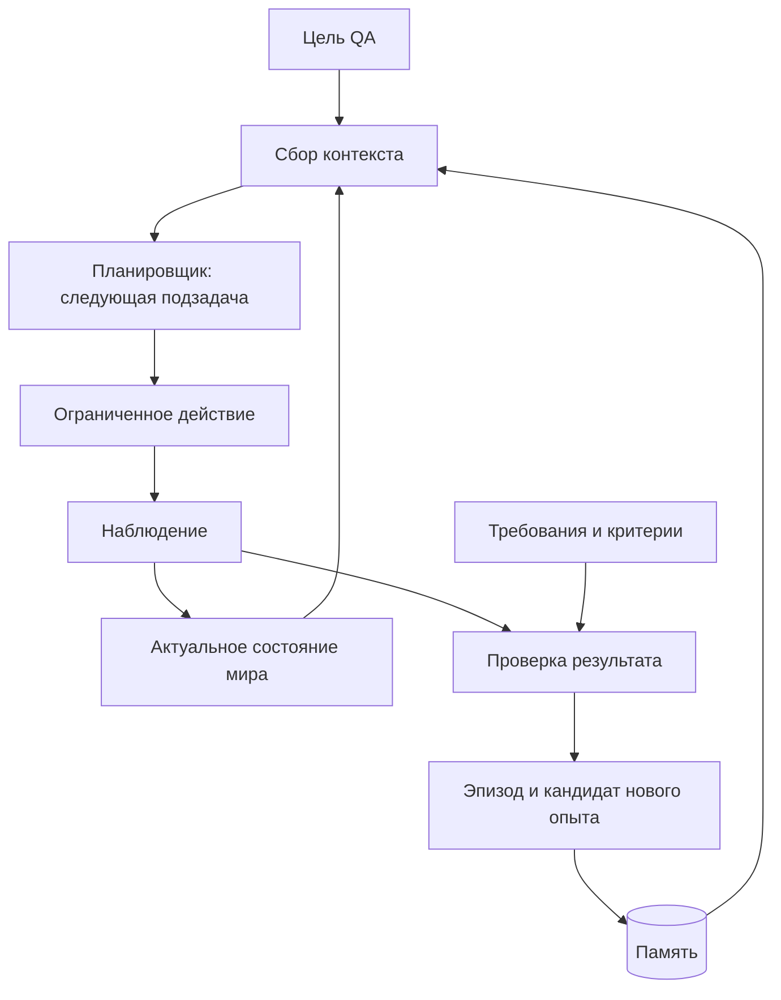

# Игровой агент с памятью

Долгосрочная цель — агент для Ocean Nomad, которому QA задаёт цель обычным языком. Агент получает данные о мире, ориентируется, строит план, действует, проверяет результат и сохраняет опыт для следующих задач. Поддерживаемые задачи расширяются по мере появления проверенных знаний, инструментов и навыков; возможность выполнять любую задачу игры заранее не обещается.

**Статус: проектирование.** Ядро агента, хранилище памяти, поиск, пространственная карта и Unity-адаптер пока не реализованы. Существующий Android-мост — только первый исполнитель и сборщик доказательств. По текущей договорённости проверки и команды устройства отложены.

## Из чего состоит «мозг»

1. **Модель** понимает цель, выбирает ближайшую подзадачу и объясняет неопределённость.
2. **Наблюдатель** получает изображение и доступную телеметрию через адаптер выбранной среды.
3. **Состояние мира** хранит актуальные положения, ориентиры, инвентарь и прогресс задачи с указанием источника и времени.
4. **Поиск памяти** находит подходящие правила, навыки, удачные и неудачные эпизоды.
5. **Исполнитель** выполняет ограниченное действие обычным игровым управлением.
6. **Проверяющий** сопоставляет наблюдаемый результат с заранее определёнными требованиями.
7. **Запись опыта** сохраняет эпизод и предлагает новое знание для подтверждения.

Это архитектура нашей системы. MCP предоставляет доступ к инструментам; хранение, поиск, проверку и актуализацию памяти проектируем отдельно. Взаимодействие модели через API — один из будущих способов запуска. Первый прототип можно развивать через Codex/Cursor без самостоятельного API-приложения.

## Что означает накопление опыта

В этой архитектуре новые сведения сохраняются во внешнем хранилище и подаются модели при подходящей задаче. Изменение весов модели и обучение собственной модели в первый этап не входят. Новый чат получает нужный опыт через чтение файлов или вызов поиска, а не через ожидание, что модель сама вспомнит прошлый запуск.

Перед решением агент загружает краткое текущее состояние, применимые требования и небольшую подборку подтверждённых навыков и предупреждений. Полные логи остаются в хранилище и извлекаются по ссылкам при необходимости. Так память может расти без передачи всей истории при каждом действии.

## Как ориентироваться в 3D

Начальная пространственная модель — объекты и связи между ними: где игрок, на что смотрит камера, какой ориентир рядом, что доступно для взаимодействия и как вернуться к известной точке.

При доступе к Unity используем предоставленные координаты, идентификаторы объектов и ориентацию. На плоту особенно полезны координаты относительно самого плота: движение плота в мире не должно менять расположение закреплённых на нём объектов в локальной карте.

По одному скриншоту нельзя считать точные мировые координаты установленными. В режиме Android без телеметрии сохраняем наблюдаемые ориентиры, относительные положения и неопределённость; если агент потерял ориентацию, получает новое наблюдение или останавливается. Подробности — в [правилах памяти](MEMORY.md).

## Источники состояния

- **Android:** фактический мобильный билд, изображения и доступные логи; сейчас есть мост на ADB.
- **Unity Editor:** структурированные данные и изучение сцены при появлении доступа. Часть данных потребует собственных инструментов игры.
- **Android с QA-телеметрией:** отдельный возможный этап, требующий участия разработчика. Само подключение MCP к Editor не открывает данные установленного APK.

Результаты этих сред различаем. Успешная задача в Editor не считается подтверждением её выполнения на Android. Предлагаемый запрос разработчику — [UNITY_BRIDGE.md](UNITY_BRIDGE.md).

## Порядок реализации

1. Согласовать представление наблюдения, опыта и критериев. Получить описание одной миссии и воспроизводимого старта.
2. Реализовать локальную запись и поиск опыта с фильтрами. До разрешения практического этапа не выполнять проверки.
3. После перехода к практике получить одну подтверждённую попытку и сохранить её как эпизод.
4. В новой сессии найти этот эпизод по цели, проверить применимость и использовать его для следующей попытки.
5. Подключить доступные данные Unity через тот же контракт наблюдения. Проверить соответствие сред отдельно.
6. Расширять набор навыков и областей игры по одному; добавлять смысловой поиск после оценки качества обычного поиска.

Первый доказуемый результат: агент находит сохранённый опыт одной миссии, применяет его в совместимых условиях и распознаёт ситуацию, когда старый опыт больше не подходит. Недельный пилот остаётся ограниченным [планом Ocean Nomad](../projects/ocean-nomad/PLAN.md).

## Технические источники

- [OpenAI: состояние диалога](https://developers.openai.com/api/docs/guides/conversation-state) — способы передавать и сохранять контекст взаимодействия.
- [OpenAI: поиск по данным](https://developers.openai.com/api/docs/guides/retrieval) — поиск релевантных материалов и фильтры по метаданным; облачный поиск пока не подключён.
- [Unity MCP](https://github.com/CoplayDev/unity-mcp) — мост к Unity Editor; [пользовательские инструменты](https://coplaydev.github.io/unity-mcp/reference/tools/core/execute_custom_tool).
