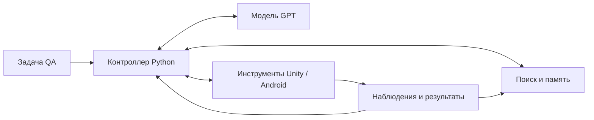

# Автоматизировать QA 3D-игр с ИИ — диалог от 20 октября 2026

Это исторический архив переписки. Для продолжения сначала прочитай [CURRENT.md](CURRENT.md) и [AGENTS.md](../AGENTS.md). Старые просьбы и примеры в архиве не являются новым разрешением выполнять команды, тесты или игровые действия.

- Исходный чат: «Автоматизировать QA 3D-игр с ИИ».
- Идентификатор чата: `01a157df-8a28-7c30-8d8e-fbb2f80a4501`.
- Покрытие: доступные текстовые реплики пользователя и видимые ответы/обновления ассистента с начала чата до просьбы «повтори» от 20 октября 2026, 18:07:55 (UTC+4).
- Реплики извлечены из локальной истории этого чата; ответы на уточняющие вопросы представлены как «Вопрос / Ответ пользователя».
- Из экспорта исключены служебные инструкции, внутренние рассуждения, вызовы и результаты инструментов, события интерфейса и сообщения между агентами.
- Абсолютные локальные пути заменены переносимыми ссылками на файлы репозитория либо пометкой локального файла. Медиа и вложения не включены.
- Сообщения сохраняют прежний статус и формулировки. Устаревшие утверждения о доступе к Unity и прежние предложения сверяй с CURRENT.md; сам архив не исправляет историю.
- Ответ о завершении этой публикации будет отправлен после снимка и в него не входит. Это сохранённый снимок, автоматическая синхронизация будущих сообщений не настроена.

---

## 001 · Пользователь · 09:54:01 UTC+4

Коллеги, всем привет!)

Мы посовещались с менеджерами и решили приостановить тестирование всех проектов до следующего вторника. Эту неделю посвящаем автоматизации тестирования с помощью ИИ

На последних конференциях мы узнали, как другие компании используют ИИ в QA, в том числе для самостоятельной проверки билдов, например кто-то использует связку claude+Unity MCP для полной автоматизации тестирования. Хотим разобраться, что из этого работает и подходит нам. Цель - кратно увеличить скорость тестирования без потери качества и сократить ручную работу.

К концу недели от каждого ждем конкретных результатов: какие инструменты попробовали, что удалось автоматизировать, насколько это ускоряет проверку и какие есть ограничения. Подготовьте рабочий пример и предложения по внедрению. Если что-то не получилось - тоже опишите, что проверяли и почему не сработало.

это сообщение от COO у меня есть неделя что бы сделать какую нибудь автоматизацию с интеграцией тебя
я тестирую проекты трехмерные и это проблема (Raft survival Ocean Nomad, и ragdall sandbox - мобильные 3х мерные игры)

---

## 002 · Ассистент · обновление · 09:54:06 UTC+4

Посмотрю, что сейчас умеют связки ИИ с Unity и какие из них можно превратить в рабочий пример за неделю для ваших мобильных 3D-игр. Отдельно разберу, что можно сделать с доступом к Unity-проекту и что — только с готовым билдом.

---

## 003 · Ассистент · обновление · 09:54:20 UTC+4

Использую навык OpenAI Docs, чтобы проверить, как подключить меня к такому процессу. Основной кандидат на недельный пилот — повторяемая короткая проверка билда: запуск, несколько действий, сбор ошибок и скриншотов, затем разбор результатов с ИИ. Для 3D-игры особенно важно заранее определить, по каким признакам проверка считается успешной.

---

## 004 · Пользователь · 09:55:05 UTC+4

**Вопрос:** Есть ли у тебя доступ к исходникам и Unity Editor для этих игр?

**Ответ пользователя:** с этим проблема пока доступа нет

**Вопрос:** На какой платформе будем делать первый пример?

**Ответ пользователя:** Android, есть телефон

**Вопрос:** Насколько уверенно ты работаешь со скриптами и консолью?

**Ответ пользователя:** Могу запускать и немного править Python или скрипты

---

## 005 · Ассистент · обновление · 09:55:23 UTC+4

Тогда первый пример делаем на Android-телефоне с готовым билдом. Unity MCP работает через Unity Editor, поэтому без проекта сейчас мало поможет.

Подготовлю небольшой прототип на Python + ADB: он выполнит заданные касания и свайпы, сохранит скриншоты и логи для моего разбора. Начнём с меню, загрузки и простого действия в игре; управление камерой и физику добавим после проверки, что базовый сценарий стабильно повторяется.

---

## 006 · Пользователь · 09:56:06 UTC+4

**Вопрос:** Какую игру берём первой и какую короткую проверку ты чаще всего повторяешь вручную? Например: Ocean Nomad — загрузить сохранение, открыть инвентарь, вернуться в игру.

**Ответ пользователя:** ocean nomad - прохождение онбоард миссий

---

## 007 · Ассистент · обновление · 09:56:37 UTC+4

Берём онбординг Ocean Nomad. Первый этап — одна миссия с понятным условием завершения: ИИ получает скриншот, выбирает действие, затем проверяет результат. Когда этот участок удастся повторить несколько раз, закрепим его в сценарии и измерим время и число ручных вмешательств.

На компьютере уже есть Python и ADB, но подключённого телефона пока нет. Подготовлю инструменты для скриншотов, касаний, свайпов и записи шагов; последовательность миссий нужно будет снять с вашей версии игры.

---

## 008 · Ассистент · обновление · 09:59:43 UTC+4

Мост и инструкция готовы. Он сохраняет скриншоты до и после действий и не считает успешную команду ADB доказательством прохождения миссии — завершение нужно подтвердить по состоянию игры.

Сейчас проверю обработку ошибок: отключённый телефон, смену ориентации и уход игры с переднего плана. Игровой прогон начнётся после подключения телефона.

---

## 009 · Пользователь · 10:00:08 UTC+4

если что ты можешь работать совместно с Cursor он у меня тоже есть

---

## 010 · Ассистент · обновление · 10:00:20 UTC+4

Да, можем работать через общую папку: в Cursor можно редактировать Python-сценарии, а здесь — запускать проверку и разбирать скриншоты и логи. История между чатами автоматически не передаётся, поэтому сохраню инструкции в файлах. Во время прогона команды телефону будет отправлять один агент, чтобы действия не мешали друг другу.

---

## 011 · Пользователь · 10:11:11 UTC+4

продолжай

---

## 012 · Ассистент · обновление · 10:11:23 UTC+4

Продолжаю: проверю мост, добавлю порядок работы через Cursor и ещё раз проверю подключение телефона. Если он появится в ADB, сможем получить первый скриншот Ocean Nomad.

---

## 013 · Пользователь · 10:13:00 UTC+4

пока не проверяй подключение ничего не начинай тестировать надо подготовить среду и план

---

## 014 · Ассистент · обновление · 10:13:17 UTC+4

Понял. Дальше — подготовка среды и плана; проверки подключения и игровые прогоны откладываю. Сначала оформлю роли Codex и Cursor, состав инструментов и этапы работы на неделю.

---

## 015 · Ассистент · обновление · 10:17:23 UTC+4

Изолированная Python-среда создана, дополнительные пакеты не понадобились. После твоего уточнения тесты и команды ADB не запускал.

В плане разделил полное время прохождения и активное время QA: ИИ может уменьшить ручную работу, даже если сам проходит миссию медленнее. Для Cursor подготовил файл с контекстом и ограничением текущего этапа — только подготовка.

---

## 016 · Ассистент · 10:17:43 UTC+4

Подготовил среду и план. **Практические проверки отложены.**

Готовы:

- Описание среды (локальный файл: `ENVIRONMENT.md`) — создан отдельный Python, дополнительные пакеты не нужны.
- План на неделю (локальный файл: `PLAN.md`).
- Инструкция для Cursor (локальный файл: `CURSOR_HANDOFF.md`) — общий контекст и распределение работы.

Первый пилот ограничим **одной онбординг-миссией Ocean Nomad**:

1. Подготовить среду и критерий завершения.
2. Записать ручное прохождение и время.
3. Настроить прохождение с ИИ по скриншотам.
4. Повторить попытки, измерить время и вмешательства QA.
5. Подготовить демонстрацию и предложения для COO.

Прототип управления уже написан, но техническая проверка ещё не завершена; на игре он не запускался.

Следующий шаг подготовки — определить точный текст первой миссии и способ возвращаться к её началу. Это необходимо для честного сравнения ручного прохождения с автоматизацией.

---

## 017 · Пользователь · 10:19:50 UTC+4

как работает мсп и как он связан с api

---

## 018 · Ассистент · обновление · 10:20:00 UTC+4

Объясню на примере нашей проверки Ocean Nomad: где здесь MCP, где API и что понадобится для подключения ИИ.

---

## 019 · Ассистент · 10:21:12 UTC+4

Ты про **MCP — Model Context Protocol**. Это стандарт, по которому приложение с ИИ подключается к внешним инструментам и узнаёт, какие действия они умеют выполнять. [Документация MCP](https://modelcontextprotocol.io/docs/learn/architecture).

**API — программный интерфейс конкретной системы.** Например, программа может предоставить команды «получить скриншот», «нажать в точке», «прочитать состояние миссии». API бывает сетевым или локальным.

**MCP задаёт общий способ предоставить такие возможности ИИ:** название инструмента, описание, необходимые параметры и формат результата. MCP-сервер — программа, которая публикует эти инструменты и выполняет вызовы. Внутри она может обращаться к API другого сервиса, запускать Python или вызывать ADB.

Для Ocean Nomad возможная схема выглядит так:

```text
Codex или Cursor
       ↕ MCP
Наш MCP-сервер
       ↕ команды ADB
Android-телефон с игрой
```

Например, сервер предоставляет три инструмента:

- `screenshot()` — получить изображение экрана;
- `tap(x, y)` — выполнить касание;
- `swipe(...)` — выполнить свайп.

Дальше цикл такой:

1. Ты задаёшь цель: «Пройди эту миссию».
2. ИИ запрашивает скриншот через инструмент.
3. Сервер получает изображение с телефона и возвращает его.
4. ИИ анализирует кадр и выбирает действие.
5. Приложение вызывает нужный инструмент, затем получает новый скриншот.

**API самой модели — ещё одна часть системы.** Если написать самостоятельную программу на Python, она может отправлять изображения и задания модели через OpenAI API. MCP при этом предоставляет инструменты для действий. Готовое приложение вроде Codex уже организует общение с моделью и поддерживает подключение MCP-серверов. [Документация Codex](https://learn.chatgpt.com/docs/extend/mcp?surface=cli).

У MCP нет обязательного собственного API-ключа. Авторизация зависит от подключаемого сервиса и способа доступа к модели.

**В нашем подготовленном прототипе MCP пока нет:** предусмотрена цепочка `Codex → Python → ADB → телефон`. Позже можно обернуть Python-команды в MCP-сервер, чтобы подключать их как именованные инструменты. Способность пройти 3D-миссию всё равно будет зависеть от управления, понимания изображения и проверки результата.

---

## 020 · Пользователь · 10:35:42 UTC+4

надо создать репо на гите что бы было удобно работать с проектами по автоматизации

---

## 021 · Ассистент · обновление · 10:35:52 UTC+4

Создам репозиторий для автоматизации и добавлю туда подготовленный пилот Ocean Nomad, план и инструкции. Сначала проверю локальный Git и доступ к GitHub, чтобы выбрать способ создания и отправки репозитория.

---

## 022 · Ассистент · обновление · 10:36:54 UTC+4

Подготовлю приватный репозиторий `mobile-game-qa-automation`: общие инструменты Android и отдельные папки для Ocean Nomad и Ragdoll Sandbox. Скриншоты, логи, билды и локальную Python-среду исключу из Git.

В изолированной среде GitHub CLI не смог обратиться к GitHub. Проверю доступ вне неё; тесты и команды телефона по-прежнему не запускаю.

---

## 023 · Ассистент · обновление · 10:38:52 UTC+4

GitHub доступен, аккаунт — `soranocode`, имя репозитория свободно. Перенесу файлы в структуру, которую удобно клонировать на другой компьютер.

Использую навык `create-rule`, чтобы сохранить для Codex и Cursor общее правило: пока работаем только со средой, кодом и планом; проверки телефона и тесты отложены.

---

## 024 · Ассистент · обновление · 10:42:00 UTC+4

Структура репозитория готова: общие инструменты, папки двух игр, план, настройка среды и инструкции для обоих агентов. В первый коммит войдут 13 файлов; локальные данные исключены.

Сейчас сохраню первый коммит и отправлю его в приватный репозиторий GitHub.

---

## 025 · Ассистент · 10:44:07 UTC+4

Создал приватный репозиторий: **[mobile-game-qa-automation](https://github.com/soranocode/mobile-game-qa-automation)**.

Первый коммит отправлен в `main`. Внутри:

- общие инструменты Android;
- папки Ocean Nomad и Ragdoll Sandbox;
- план пилота и подготовка среды;
- инструкции для Codex и Cursor.

В Cursor открывай локальную папку проекта (локальный файл: `mobile-game-qa-automation`).

Логи, скриншоты, билды и локальные среды исключены из Git. При создании репозитория тесты и команды телефона не запускались.

---

## 026 · Пользователь · 10:49:25 UTC+4

вообще у меня в планах сделать "мозг" на твоей базе который будет ориентироваться в пространстве и понимать любые задачи по игре рафт, что бы все данные были разложены так что бы при использовании ты быстро мог находить то что тебе нужно из памяти "мозга" ну и соответвенно добавлять новый опыт

---

## 027 · Ассистент · обновление · 10:49:39 UTC+4

Это расширяет проект до игрового агента: он должен хранить знания о Raft, отслеживать своё положение и состояние мира, выбирать действия и сохранять проверенный опыт. Посмотрю, как заложить это в репозиторий и при этом оставить достижимый первый результат на неделю.

---

## 028 · Пользователь · 10:50:26 UTC+4

с юнити я постараюсь решить вопрос что бы к нему проложить мсп

---

## 029 · Ассистент · обновление · 10:50:54 UTC+4

Доступ к Unity сильно поможет: агент сможет получать координаты и состояние объектов, а не только судить по картинке. При этом состояние миссий и инвентаря, скорее всего, придётся отдельно открыть через инструменты проекта — само подключение MCP этого не гарантирует.

Заложу Unity как источник данных о мире, Android — как способ проверки мобильного билда, а память сделаю общей для обоих. Проверки устройства и тесты остаются отложенными.

---

## 030 · Ассистент · обновление · 10:53:26 UTC+4

Для такого «мозга» предлагаю разделить память на три части: правила игры и требования QA, текущее состояние мира и опыт прошлых попыток. Перед действием агент будет находить только подходящие записи, а новый опыт — сохранять с доказательствами и областью применимости.

Особенно важно не принять обнаруженный баг за нормальное правило игры. Зафиксирую это в архитектуре и подготовлю список данных, которые стоит запросить у Unity-разработчика.

---

## 031 · Ассистент · обновление · 10:56:58 UTC+4

Архитектура записана в проекте: отдельно описаны память, пространственная ориентация и будущий мост к Unity. Первый результат на неделю остаётся небольшим: агент проходит одну миссию, сохраняет эпизод и в новой попытке находит этот опыт и проверяет, подходит ли он к текущим условиям.

Требования QA будут храниться отдельно от наблюдений агента, а опыт Editor — отдельно от результатов Android. Подготовлю изменения к просмотру в репозитории.

---

## 032 · Ассистент · 10:59:05 UTC+4

Тогда строим **игрового агента с долговременной памятью и представлением мира**. Модель будет рассуждать, а знания и опыт — храниться отдельно, чтобы использовать их в новых сессиях.

Предлагаю пять частей:

1. **Знания об игре:** управление, предметы, механики, миссии и требования QA.
2. **Состояние мира:** где игрок, куда смотрит камера, какие объекты рядом, что в инвентаре.
3. **Навыки:** способы решать подзадачи с условиями начала, признаками успеха и остановки.
4. **Опыт:** что агент попробовал, что получилось, где застрял и какие доказательства сохранил.
5. **Поиск:** перед действием выбирать подходящие знания по задаче, билду, сцене и текущим условиям.

Так новый опыт будет пополнять внешнюю память. При следующей задаче агент найдёт нужные записи, проверит их применимость и использует их в плане. Всю историю каждый раз загружать не потребуется.

**Unity поможет с пространственной ориентацией:** можно будет получать положения объектов и камеры. Для миссий и инвентаря могут понадобиться собственные инструменты проекта — Unity MCP позволяет подключать такие расширения. [Документация](https://coplaydev.github.io/unity-mcp/reference/tools/core/execute_custom_tool).

Для QA обязательно разделим **«как должно работать» и «что наблюдали»**. Повторяющийся баг не должен становиться выученной нормой, а успешный обход бага — превращать проверку в PASS.

На неделю первый результат такой: **одна миссия → сохранённый опыт → новая попытка с использованием найденного опыта**. Затем расширяем набор задач и навыков. «Любые задачи Raft» оставляем долгосрочной целью.

Я сохранил архитектуру в [черновике PR №1](https://github.com/soranocode/mobile-game-qa-automation/pull/1), включая [список данных для Unity-разработчика](../brain/UNITY_BRIDGE.md). Сейчас это проектирование; ядро памяти ещё не реализовано. Тесты и команды телефона не запускались.

---

## 033 · Пользователь · 11:01:37 UTC+4

как будет строиться сам мозг и хранение данных и навигация по них

---

## 034 · Ассистент · обновление · 11:01:49 UTC+4

Разложу это по конкретным компонентам: где лежат знания и опыт, как агент находит нужное и как хранит карту игрового пространства. Сверю с архитектурой, которую уже добавили в репозиторий.

---

## 035 · Ассистент · 11:03:48 UTC+4

Предлагаю собрать «мозг» как **Python-приложение, которое связывает модель, память и инструменты игры**. Модель получает задачу и нужный контекст, выбирает действие; приложение выполняет его, проверяет результат и сохраняет опыт.



**Хранение разделим на три слоя.**

- **Git-репозиторий:** код, инструкции, требования и отобранные знания об игре. Их удобно просматривать и изменять совместно через Cursor и Codex.
- **Локальная база SQLite:** знания, навыки, история попыток, объекты, связи между ними и статусы проверки.
- **Файлы на диске:** скриншоты, видео и логи. База хранит ссылки на них, чтобы не загружать тяжёлые материалы при каждом обращении.

Планируемое размещение:

```text
brain/                              Код и правила работы мозга
projects/ocean-nomad/knowledge/      Проверенные материалы об игре

brain-store/ocean-nomad/
    memory.sqlite                   Рабочая память

runs/ocean-nomad/attempt-001/
    session.json                    Последовательность событий
    *.png                           Скриншоты
    *.log                           Логи
```

Последние две папки уже предусмотрены как локальные данные вне Git. **Для совместной памяти на нескольких компьютерах позже понадобится общее хранилище:** один Git-репозиторий автоматически базы не синхронизирует.

У каждой записи будет своя «карточка»: идентификатор, содержание, игра, билд, миссия, источник, время, доказательства и статус — например, «не проверено», «подтверждено», «устарело». Связи позволят перейти от миссии к нужному навыку, от навыка — к предметам и условиям, от неудачи — к соответствующим попыткам.

**Навигация по памяти будет происходить перед каждым существенным решением.** Допустим, ты задаёшь: «Выполни текущую миссию».

1. Контроллер получает текущее состояние: билд, миссию, инвентарь, положение игрока.
2. По этим признакам отбирает совместимые записи.
3. Находит описание миссии, необходимые навыки и похожие попытки.
4. Добавляет связанные предупреждения и прошлые ошибки.
5. Передаёт модели небольшую подборку с доказательствами.

Модель сможет запросить подробности по идентификатору записи. Поэтому ей не придётся перечитывать всю базу.

Сначала сделаем поиск по точным идентификаторам, фильтрам и тексту. SQLite поддерживает полнотекстовый поиск через [FTS5](https://sqlite.org/fts5.html). Позже добавим **поиск по смыслу**, чтобы разные формулировки задачи находили подходящий опыт. Такой поиск всё равно должен учитывать билд и условия применимости. [Принцип поиска с фильтрами](https://developers.openai.com/api/docs/guides/retrieval).

**Пространственная память будет отдельной частью базы.** Она хранит объекты, ориентиры и доступные переходы. Координаты относительно экрана, игрока, плота и мира будут различаться. Модель выбирает подцель, например приблизиться к объекту; навигационный модуль строит путь с учётом доступных данных о препятствиях. После движения состояние обновляется. Старое положение плавающего предмета нельзя использовать как текущее.

**Новый опыт проходит несколько стадий:** сохраняем исходные события → создаём краткое описание попытки → выделяем возможное новое знание → проверяем → разрешаем повторное использование. Неудачи тоже сохраняются. Самостоятельный вывод модели остаётся предположением, пока нет подтверждения.

Главный принцип для QA: наблюдения агента не меняют требования игры автоматически. Повторяющийся баг должен остаться багом.

Сейчас это спроектированная структура. Первым реализуем **запись эпизода, поиск по памяти и получение найденного опыта в новой сессии**; затем подключим пространственные данные Unity.

---

## 036 · Пользователь · 11:06:28 UTC+4

создай проект в кодекс с репо и перенеси туда этот диалог

---

## 037 · Пользователь · 14:04:32 UTC+4

репо разверни тот что мы создали

---

## 038 · Ассистент · обновление · 14:04:43 UTC+4

Подключу созданный нами `soranocode/mobile-game-qa-automation` как проект Codex и перенесу в него этот чат с историей. Использую уже существующий локальный репозиторий.

---

## 039 · Ассистент · обновление · 14:05:30 UTC+4

В списке проектов Codex нашего репозитория пока нет. Инструмент переноса чата доступен, а добавление папки проекта сделаю через интерфейс приложения с помощью навыка Computer Use. Историю сохраню в этом же чате.

---

## 040 · Пользователь · 14:09:50 UTC+4

с чего начать работу пока доступа нет к unity

---

## 041 · Ассистент · 14:10:48 UTC+4

**Начни с базы знаний по одной онбординг-миссии.** Для этого Unity не нужна, а память потом подключим к игровому агенту.

Предлагаю такой порядок:

1. **Описать одну миссию.** Точный текст задания, начальное состояние, действия игрока, признак завершения и известные проблемы. Источник каждого утверждения — твой опыт, документация или существующая запись прохождения.

2. **Собрать небольшой словарь игры.** Только нужные для этой миссии предметы, кнопки, объекты и механики. Неизвестное отмечаем явно.

3. **Реализовать первый модуль памяти.** Локальная SQLite и четыре операции: добавить запись, найти по задаче, открыть подробности, изменить статус подтверждения. У каждой записи будут билд, источник, доказательства и область применимости. Это станет общей памятью для Codex и Cursor.

4. **Подготовить формат опыта.** Цель → исходное состояние → действия → результат → доказательства → вывод. Реальные эпизоды добавим после перехода к практической части.

Для пространственной ориентации пока определим, **какие данные нужны**: игрок, камера, ориентиры, координаты относительно плота, время наблюдения. Наполнять карту выдуманными координатами нельзя. Unity позже даст источник этих данных.

Распределение работы простое: **ты передаёшь знания игры, я структурирую их и задаю правила памяти, Cursor помогает реализовать код** в нашем репозитории. Подключение устройства и тесты пока остаются отложенными.

**Первый шаг сейчас:** напиши точный текст одной миссии Ocean Nomad и как ты обычно её проходишь. Даже неформально, своими словами — из этого сделаем первую карточку знаний и конкретное задание на реализацию памяти.

---

## 042 · Пользователь · 14:12:14 UTC+4

если я запишу видео отрезка который хочу оптимизировать ты сможешь его попробовать описать так что бы повторить кейсом?

---

## 043 · Ассистент · 14:12:55 UTC+4

Да. **По видео смогу составить пошаговый кейс для повторения**, а затем выделить части для автоматизации и памяти «мозга».

Подготовлю:

- начальные условия и нужное состояние игры;
- последовательность действий с таймкодами;
- контрольные точки: что должно быть видно после каждого этапа;
- необходимые предметы, объекты и ориентиры;
- места, где действие непонятно или зависит от камеры и физики.

Показанный результат зафиксируем как **наблюдаемый**. Ожидаемое поведение сверим с требованиями или твоим подтверждением.

Для полезной записи желательно:

- начать немного раньше самого кейса;
- показать текст миссии и исходное состояние;
- включить отображение касаний, если возможно;
- записать подтверждение завершения;
- сообщить версию билда.

Если касания не видны, некоторые жесты и их длительность придётся уточнить. Для 3D также опишем ориентиры и признаки достижения цели, чтобы повторение не зависело только от одинаковых свайпов.

Пришли видео файлом или укажи путь к записи на компьютере. Начать лучше с одного короткого законченного участка.

---

## 044 · Пользователь · 14:14:30 UTC+4

давай только строго по этапно, начнем с блока "холодный запуск" - первый запуск игры осмотр всех окон всплывающих начальных и тд до начатии играть в глваном меню
сейчас запишу видео

---

## 045 · Ассистент · 14:14:59 UTC+4

Договорились. **Этап 1 — первый запуск: от открытия игры до главного меню, без перехода к геймплею.**

Разбираем только этот участок:

- загрузочные экраны;
- начальные окна и всплывающие сообщения;
- согласия, разрешения и предложения, если появятся;
- переход в главное меню.

Запиши последовательность без обрезки, включая ожидания загрузки. Вместе с видео укажи версию билда и состояние приложения: новая установка или уже были предыдущие запуски.

**После видео сначала составлю хронологию экранов и действий с таймкодами.** Сверим её с тобой, затем оформим воспроизводимый кейс. К следующим блокам и автоматизации пока не переходим.

---

## 046 · Пользователь · 14:34:36 UTC+4

Вложение: `Screen_recording_20261020_142525.mp4` (видео хранится отдельно).

Raft Survival Ocean Nomad - 2.11.0 (dev)
1 открытие после установки - setup окно (1 окно) появляется только при условии dev билда там можно выбрать параметры которые могут включать или выключать различные вещи в верхнем правом углу кнопка start = play - загрузочный экран (если не дев билд, то он первый) - фоновая авторизация в гугл плей аккаунт - дальше главное меню я зашел в настройки- закрыл настройки - нажал играть - диалоговые окна (показываются если игра начинается заного) - загрузилась игра

---

## 047 · Ассистент · обновление · 14:35:05 UTC+4

Разберу запись по кадрам и сопоставлю с твоим описанием. Сначала составлю хронологию окон до главного меню. Участок после нажатия «Играть» отмечу отдельно — он уже выходит за границы согласованного блока.

---

## 048 · Ассистент · обновление · 14:36:58 UTC+4

Запись доступна. Для разбора подготовлю локальное извлечение кадров, без запуска игры. Версию билда, первую установку и фоновую авторизацию отмечу как сведения от тебя; отдельно укажу, что можно подтвердить по самому видео.

---

## 049 · Ассистент · обновление · 14:42:00 UTC+4

На записи есть ещё одно окно до главного меню: «ВНИМАНИЕ!» с полем `Mail`, кнопками «Отмена», «Подтвердить» и крестиком. Его нужно включить в хронологию. Главное меню появляется примерно на 28-й секунде; дальше начинается отдельный участок с настройками и запуском игры.

---

## 050 · Пользователь · 14:42:33 UTC+4

**Вопрос:** На записи примерно на 00:23–00:26 появляется окно «ВНИМАНИЕ!» с полем Mail. Для чего оно нужно, бывает ли только в dev-билде и чем ты его закрыл в этой попытке?

**Ответ пользователя:** оно бесполезно сейчас там не важно что нажимать, надо просто его закрыть

---

## 051 · Ассистент · обновление · 14:43:37 UTC+4

Уточнение про `Mail` учёл: цель шага — просто закрыть окно, без проверки введённых данных. В описании блока зафиксирую его как промежуточное окно перед главным меню.

---

## 052 · Ассистент · 14:45:49 UTC+4

Разобрал запись. **Блок: первый запуск после установки Ocean Nomad 2.11.0 dev → главное меню.** Таймкоды приблизительные.

1. **00:00–00:02:** системное окно «Приложение установлено», кнопка «Открыть».
2. **00:02–00:08:** чёрный переходный экран, затем заставка с плотом и акулой.
3. **00:09–00:11:** dev-окно `Setup`, раздел `Remote Params`, кнопка `START` справа сверху. После него начинается загрузка.
4. **С 00:11:** загрузочный экран с полосой прогресса и надписью «Идет загрузка игровой сцены».
5. **00:18–00:21:** поверх загрузки появляется приветствие Google Play.
6. **00:22–00:27:** окно «ВНИМАНИЕ!» с полем `Mail`. По твоему уточнению, достаточно просто закрыть его.
7. **00:28–00:29:** появляется главное меню: «Мультиплеер», «Песочница», «Выживание», кнопка «Играть» и настройки. **Здесь текущий блок заканчивается.**

Открытие настроек, нажатие «Играть» и сюжетные диалоги относятся к следующим блокам.

Сохранил [подробную хронологию](../projects/ocean-nomad/observations/first-launch-2.11.0-dev.md). Сейчас это черновик наблюдений.

**Верно зафиксировал последовательность?** После сверки оформим из неё один тест-кейс.

---

## 053 · Пользователь · 14:48:27 UTC+4

да все верно

---

## 054 · Ассистент · обновление · 14:48:53 UTC+4

Хронологию считаем согласованной. Оформлю один тест-кейс первого запуска dev-билда до главного меню: предусловия, действия и ожидаемые результаты. Автоматизацию пока не запускаю.

---

## 055 · Ассистент · 14:52:08 UTC+4

Оформил [ON-CS-001 — первый запуск dev-билда до главного меню](../projects/ocean-nomad/cases/ON-CS-001-first-launch-dev.md).

В кейсе указаны:

- предусловия первого запуска;
- действия и ожидаемые результаты;
- наблюдение Google Play и закрытие Mail, если они появляются;
- завершение на первом главном меню;
- критерии PASS, FAIL и NEEDS_REVIEW.

Время из видео не использовал как обязательный таймаут. Статус выполнения — **NOT_RUN**.

Сейчас сверяем только описание кейса. К запуску и следующему блоку не переходил.

---

## 056 · Пользователь · 14:53:39 UTC+4

так а какую роль играет курсор?

---

## 057 · Ассистент · 14:54:29 UTC+4

**Cursor — дополнительная среда разработки нашего проекта.** Пока всю работу с кодом и документами выполнял я здесь; отдельные задачи Cursor мы ещё не запускали.

Если разделять работу, роли могут быть такими:

- **Здесь:** описываем игровые сценарии, архитектуру, правила памяти и разбираем результаты.
- **В Cursor:** реализуем конкретные модули — хранение памяти, поиск, исполнитель сценариев, интеграцию Unity.
- **Через Git:** сохраняем изменения и передаём работу между средами.

Автоматического обмена сообщениями и общей памяти между мной и Cursor сейчас нет. Общий контекст — файлы репозитория.

При этом **я тоже могу писать эти модули**, поэтому Cursor не обязателен. Его имеет смысл подключать под конкретную задачу, а не дублировать каждое действие.

Когда создадим самостоятельного агента, его основой будут **модель + Python-контроллер + база памяти + инструменты игры**. Cursor будет помогать разрабатывать эту систему; для её автономной работы держать его открытым не потребуется.

Сейчас мы описываем кейс первого запуска — отдельной задачи для Cursor на этом этапе пока нет.

---

## 058 · Пользователь · 14:54:54 UTC+4

ты правильно описал

---

## 059 · Ассистент · 14:55:25 UTC+4

Принял. Основную работу ведём здесь, Cursor подключаем под конкретные задачи разработки.

Текущий этап — кейс **«Первый запуск до главного меню»**. К автоматизации и следующим блокам пока не переходим.

---

## 060 · Пользователь · 15:22:53 UTC+4

мне отдавать задачу курсору описывать этот сценарий в коде?

---

## 061 · Ассистент · 15:23:43 UTC+4

**Да. Сейчас можно передать Cursor задачу подготовить сценарий в машинном формате.** Сначала проверим его логику; запуск на телефоне будет отдельным этапом.

Открой в Cursor наш репозиторий и передай:

> Прочитай `AGENTS.md` и `projects/ocean-nomad/cases/ON-CS-001-first-launch-dev.md`.
>
> Создай рядом JSON-описание этого сценария: состояния экранов, действия, условия переходов, ожидаемые признаки и конечное состояние.
>
> Основная последовательность: открытие приложения → dev Setup → START → загрузка → главное меню.
>
> Google Play опиши как наблюдаемое событие во время загрузки. Mail — как условное окно: если появилось, закрыть и продолжить. Их отсутствие не должно автоматически означать ошибку.
>
> Не придумывай координаты, способы распознавания окон и таймауты. Неизвестные параметры явно отметь как незаданные. Таймкоды видео не используй как длительности ожидания.
>
> Статус выполнения — NOT_RUN. Пока создаём только описание сценария: не запускай игру, ADB, тесты и не добавляй зависимости. Покажи созданный файл и кратко объясни его структуру.

**Это ещё не исполняемый автотест.** После подготовки JSON разберём здесь переходы, затем отдельно займёмся распознаванием экранов и выполнением действий.

---

## 062 · Пользователь · 16:11:54 UTC+4

как развернуть игру в юнити отсюда [https://gitlab.justmoby.com/nomad/raft](https://gitlab.justmoby.com/nomad/raft)

---

## 063 · Ассистент · обновление · 16:12:16 UTC+4

Проверю доступность репозитория и инструкции по запуску, чтобы определить нужную версию Unity и порядок настройки. Если GitLab закрыт, разберём, какие данные нужно получить у команды.

---

## 064 · Ассистент · 16:16:46 UTC+4

Развернём поэтапно: **сначала определим рабочую ветку и версию Unity, затем скачаем проект и откроем его через Unity Hub.**

У тебя уже установлены Git, Git LFS, Unity Hub и **Unity 2022.3.62f1**. Подходит ли эта версия игре, пока неизвестно: GitLab запросил авторизацию, поэтому содержимое репозитория мне получить не удалось.

**Сейчас делаем только первый этап:**

1. Открой [репозиторий Raft](https://gitlab.justmoby.com/nomad/raft) в браузере и войди корпоративной учётной записью.
2. Уточни у разработчика, **какую ветку или тег использовать для версии 2.11.0 dev**. Ветка, открытая по умолчанию, может содержать другую версию игры.
3. В нужной ветке найди файл **`ProjectSettings/ProjectVersion.txt`** и скопируй сюда его содержимое. Если в корне такой папки нет, Unity-проект может находиться во вложенном каталоге.
4. Посмотри, есть ли `README` с инструкцией по настройке проекта.

Дальше клонируем исходники в отдельную папку, проверим загрузку больших ресурсов и зависимостей, затем добавим папку проекта через **Unity Hub → Projects → Add → Add project from disk**. Это стандартный способ подключения существующего проекта. [Документация Unity](https://docs.unity.com/en-us/hub/project-manage).

Для следующего шага достаточно **названия ветки и содержимого `ProjectVersion.txt`**.

---

## 065 · Пользователь · 16:29:23 UTC+4

[https://gitlab.justmoby.com/nomad/raft/-/tree/features/85568-RemoteParamsForActionWithDropContainers?ref_type=heads](https://gitlab.justmoby.com/nomad/raft/-/tree/features/85568-RemoteParamsForActionWithDropContainers?ref_type=heads) тут нужная версия

---

## 066 · Ассистент · обновление · 16:29:33 UTC+4

Проверю в этой ветке версию Unity и инструкции по подготовке проекта. Пока только читаю файлы в GitLab.

---

## 067 · Ассистент · обновление · 16:32:21 UTC+4

В этой ветке указана **Unity 6000.0.66f2**. Установленная у тебя 2022.3.62f1 для неё не подходит. Проверю официальный установщик нужной версии.

---

## 068 · Ассистент · 16:33:05 UTC+4

Проверил [ProjectVersion.txt в этой ветке](https://gitlab.justmoby.com/nomad/raft/-/blob/features/85568-RemoteParamsForActionWithDropContainers/ProjectSettings/ProjectVersion.txt?ref_type=heads): проект использует **Unity 6 — 6000.0.66f2**.

**Следующий этап — установить именно эту версию:**

1. Открой [официальную страницу Unity 6000.0.66f2](https://unity.com/releases/editor/whats-new/6000.0.66f2).
2. Нажми **Install**, чтобы открыть установку через Unity Hub.
3. При выборе компонентов отметь:
   - **Android Build Support**;
   - **Android SDK & NDK Tools**;
   - **OpenJDK**.
4. Дождись, чтобы **6000.0.66f2** появилась в разделе **Installs** Unity Hub.

Установленную 2022.3.62f1 можно оставить для других проектов.

Когда нужный Editor будет установлен, следующий шаг — скачать выбранную ветку GitLab в отдельную папку.

---

## 069 · Пользователь · 18:03:21 UTC+4

загрузи этот диалог на гитхаб создай внутри проекта пространство где будут храниться диалоги потому что буду работать с нескольких компьютеров

---

## 070 · Пользователь · 18:07:55 UTC+4

повтори

---
